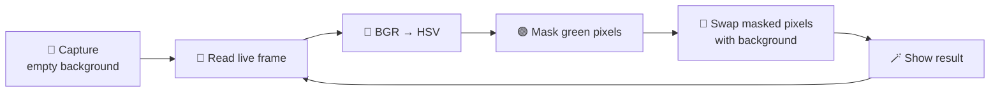

<div align="center">


[](https://python.org)
[](https://opencv.org)
[](https://numpy.org)
[](#-quick-start)
[](LICENSE)

<br />

[🎬 Demo](#-demo) •
[🪄 The Spell](#-the-spell) •
[⚡ Quick Start](#-quick-start) •
[🎛️ Tuning](#%EF%B8%8F-tuning-the-magic) •
[🧪 Under the Hood](#-under-the-hood) •
[🛠️ Troubleshooting](#%EF%B8%8F-troubleshooting)

</div>

---

## 🎬 Demo

<!-- Replace with a real GIF: walk into frame, raise the green cloth, body disappears. -->
<div align="center">
  
</div>

| 👤 Without the cloak | 🫥 With the cloak |
|:---:|:---:|
|  |  |

## 🪄 The Spell

No machine learning, no GPU, no green screen studio. The cloak works because the camera never moves, so the app can remember what is *behind* you.



1. 📸 **Capture** a clean background frame on startup (you step out of view).
2. 🎥 **Read** each live frame from the webcam.
3. 🎨 **Convert** the frame to HSV, where color is easier to isolate than in RGB.
4. 🟢 **Mask** every pixel that falls inside the green range.
5. 🔁 **Replace** those pixels with the saved background.
6. 🪄 **Display** the blended frame, so the cloth looks like it is made of air.

## ⚡ Quick Start

### Requirements

- 🐍 Python 3.8 or later
- 📷 A webcam
- 🟢 A **solid green cloth**, matte and not shiny

### Install and run

```bash
git clone https://github.com/<your-username>/potter-invisibility-cloak.git
cd potter-invisibility-cloak

pip install opencv-python numpy
python main.py
```

### The ritual

| Step | What to do |
|:---:|---|
| 1️⃣ | **Step out of frame** while the background is captured |
| 2️⃣ | Wait for the capture to finish, then step back in |
| 3️⃣ | Hold or wear the green cloth in front of you |
| 4️⃣ | Watch the cloth disappear and show what is behind it ✨ |
| 5️⃣ | Press **`q`** to quit |

> [!IMPORTANT]
> **Keep the camera still.** If the camera moves after the background is captured, the "invisible" area will show a ghost edge. Use a tripod or lean the laptop against something solid.

## 🎛️ Tuning the Magic

The effect depends on one thing: the HSV range for your cloth under your lighting. The default range in `main.py` is:

```python
lower_green = np.array([50, 80, 50])
upper_green = np.array([90, 255, 255])
```

HSV in OpenCV uses these ranges:

| Channel | Range | Meaning |
|---|:---:|---|
| **H** (Hue) | 0 – 179 | The color itself (green sits around 60) |
| **S** (Saturation) | 0 – 255 | How vivid the color is |
| **V** (Value) | 0 – 255 | How bright it is |

<details>
<summary><b>🎨 Other cloak colors</b></summary>

<br />

Starting points only. Adjust them for your cloth and lighting.

| Cloak color | Lower `[H, S, V]` | Upper `[H, S, V]` |
|---|---|---|
| 🟢 Green | `[50, 80, 50]` | `[90, 255, 255]` |
| 🔵 Blue | `[95, 80, 50]` | `[130, 255, 255]` |
| 🔴 Red (low) | `[0, 120, 70]` | `[10, 255, 255]` |
| 🔴 Red (high) | `[170, 120, 70]` | `[179, 255, 255]` |

Red sits at **both ends** of the hue scale, so it needs two masks combined with `cv2.bitwise_or`.

</details>

<details>
<summary><b>🎚️ Live trackbar tuner</b></summary>

<br />

Drop this into a separate file to find your values by eye:

```python
import cv2
import numpy as np

cap = cv2.VideoCapture(0)
cv2.namedWindow("tuner")
for name, init, top in [("H low", 50, 179), ("H high", 90, 179),
                        ("S low", 80, 255), ("V low", 50, 255)]:
    cv2.createTrackbar(name, "tuner", init, top, lambda x: None)

while True:
    ok, frame = cap.read()
    if not ok:
        break
    hsv = cv2.cvtColor(frame, cv2.COLOR_BGR2HSV)
    lo = np.array([cv2.getTrackbarPos("H low", "tuner"),
                   cv2.getTrackbarPos("S low", "tuner"),
                   cv2.getTrackbarPos("V low", "tuner")])
    hi = np.array([cv2.getTrackbarPos("H high", "tuner"), 255, 255])
    cv2.imshow("tuner", cv2.inRange(hsv, lo, hi))
    if cv2.waitKey(1) & 0xFF == ord("q"):
        break

cap.release()
cv2.destroyAllWindows()
```

You want the cloth to be solid **white** in the mask window and everything else **black**.

</details>

## 🧪 Under the Hood

The core idea in a few lines:

```python
hsv  = cv2.cvtColor(frame, cv2.COLOR_BGR2HSV)
mask = cv2.inRange(hsv, lower_green, upper_green)   # cloth = white

cloak_area   = cv2.bitwise_and(background, background, mask=mask)
visible_area = cv2.bitwise_and(frame, frame, mask=cv2.bitwise_not(mask))

result = cv2.add(cloak_area, visible_area)
```

<details>
<summary><b>✨ Optional: smoother edges</b></summary>

<br />

Raw masks are noisy. Cleaning them up removes speckles and fills small holes in the cloth:

```python
kernel = np.ones((3, 3), np.uint8)
mask = cv2.morphologyEx(mask, cv2.MORPH_OPEN, kernel, iterations=2)
mask = cv2.dilate(mask, kernel, iterations=1)
```

`MORPH_OPEN` removes stray green pixels, and `dilate` grows the mask slightly so the cloth's edge doesn't glow.

</details>

## 📁 Project Structure

```text
potter-invisibility-cloak/
├── main.py       # Background capture, color mask, frame blending
├── docs/         # Banner, demo GIF, before/after images
└── README.md
```

## 🛠️ Troubleshooting

| Problem | Fix |
|---|---|
| Cloth only partly disappears | Widen the HSV range, or add light so the cloth is evenly lit |
| Parts of your clothes vanish too | Don't wear green, or narrow the range with the trackbar tuner |
| Visible ghost or edge around the cloth | Keep the camera perfectly still and clean up the mask (see above) |
| Background looks wrong or has you in it | Restart and stay fully out of frame during capture |
| Flickering or patchy mask | Use a matte cloth, light it evenly, and turn off the camera's auto exposure if you can |
| Black window or camera error | Change `VideoCapture(0)` to `VideoCapture(1)`, and close other apps using the webcam |
| Slow or laggy | Lower the capture resolution, for example `cap.set(cv2.CAP_PROP_FRAME_WIDTH, 640)` |

## 💡 Tips for the Best Effect

- 🪟 **Light evenly.** Shadows and highlights shift the cloth's color out of range.
- 🧵 **Use matte fabric.** Shiny cloth reflects light and breaks the mask.
- 🧱 **Pick a plain background** with no green in it.
- 🎞️ **Disable auto-exposure and auto-white-balance** if your camera allows it, since brightness shifts can reveal the swap.

## 🗺️ Roadmap

- [x] Real-time green-cloth invisibility
- [x] HSV range tuning
- [ ] Live trackbar controls built into the main app
- [ ] Press `b` to recapture the background without restarting
- [ ] Color picker: click the cloth to set the range automatically
- [ ] Mask cleanup and edge softening
- [ ] Support for red and blue cloaks out of the box
- [ ] Save a screenshot or recording with a keypress

## 🤝 Contributing

Ideas and pull requests are welcome.

```bash
git checkout -b feature/your-spell
git commit -m "Add your spell"
git push origin feature/your-spell
```

Then open a Pull Request.

## 📄 License

Released under the [MIT License](LICENSE).

<div align="center">

<br />

*"I solemnly swear that I am up to no good."* 🪄

Built with Python, OpenCV, and a very green bedsheet.

⭐ **Star the repo if it made you disappear.**

</div>
